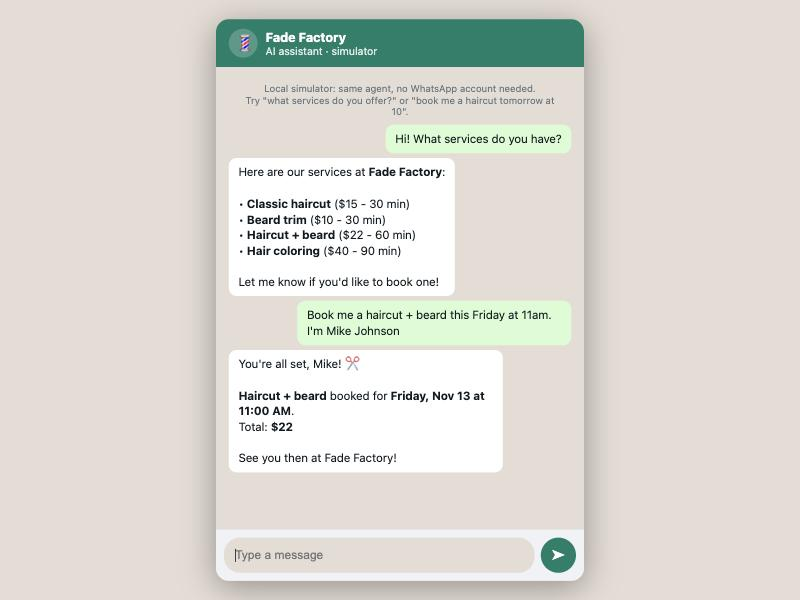

# WhatsApp AI Agent

An AI assistant that books real appointments over **WhatsApp**, built on the **official WhatsApp Cloud API** (Meta). Works with **Claude or Gemini** (pick with `PROVIDER` in `.env`; the Gemini path falls back to a second model when one is overloaded). The demo business is a barbershop, but the WhatsApp layer works for any business logic you plug into it.

*(¿Español? Abajo hay un resumen en español.)*



```
Customer on WhatsApp ──▶ Meta Cloud API ──▶ POST /webhook ──▶ AI agent ──▶ tools ──▶ SQLite
                                 ◀── send message ◀── reply ◀──┘
```

## Features and current limits

- **Webhook signature verification.** Every incoming webhook is checked with HMAC-SHA256 against the Meta app secret, so nobody can fake customer messages by POSTing to the endpoint.
- **Deduplication.** Recent message IDs are kept in memory for 10 minutes to reduce duplicate replies. This does not survive restarts or coordinate multiple workers.
- **Fast ACK.** The webhook returns 200 immediately and the AI runs in a background task — slow webhooks get retried and eventually disabled by Meta.
- **No double-booking, guaranteed by the database.** A partial unique index allows only one *active* appointment per slot. Tested with 20 concurrent requests for the same slot: exactly one wins.
- **Customer isolation.** The customer's phone number is injected by the system on each tool call to restrict access to that customer's appointments. This is not a guarantee against every prompt-injection attack.
- **Business rules live in code, not in the prompt.** The model cannot invent prices, book on Sundays or at 10:15 — the tools refuse.
- **Customers never see technical errors.** Any failure rolls the conversation back and answers with a friendly message; details go to a rotating log.
- **Automated tests** (pytest), including the agent loop against a scripted fake model — they run with no API key and no network.

This is a portfolio demo, not a production deployment. Background tasks and conversation history are in memory; a restart can lose pending work. The local simulator has no authentication and must not be exposed publicly. A real deployment needs durable message processing, access controls, monitoring, and a review of data protection and Meta configuration.

## Run it in 2 minutes (no Meta account needed)

The project includes a **local simulator**: a WhatsApp-style chat page that talks to the exact same agent.

```bash
git clone https://github.com/andresnv22/whatsapp-ai-agent
cd whatsapp-ai-agent
cp .env.example .env        # paste your ANTHROPIC_API_KEY (or GEMINI_API_KEY + PROVIDER=gemini)
uv sync
uv run uvicorn app.main:app
```

Open http://localhost:8000 and chat: *"book me a haircut tomorrow at 10, my name is Ana Ruiz"*.

Run the tests:

```bash
uv run pytest
```

## Connect it to real WhatsApp

1. Create an app at [Meta for Developers](https://developers.facebook.com) → add the **WhatsApp** product. Meta gives you a **free test number**.
2. Copy the token and phone number id into `.env` (`WHATSAPP_TOKEN`, `WHATSAPP_PHONE_NUMBER_ID`), plus your app secret (`WHATSAPP_APP_SECRET`) and a verify token you invent.
3. Expose the server with a public URL (for development: `ngrok http 8000` or `cloudflared tunnel`).
4. In Meta's WhatsApp → Configuration, set the webhook to `https://your-url/webhook`, paste the same verify token, and subscribe to **messages**.
5. Message the test number from your phone. That's it.

## Project layout

| File | What it does |
|---|---|
| `app/main.py` | FastAPI server: Meta webhook + local simulator |
| `app/whatsapp.py` | Cloud API client: signatures, dedup, send/mark-read |
| `app/agent.py` | The agentic loop (Claude + tools, friendly error handling) |
| `app/tools.py` | Business rules: availability, booking, cancellation |
| `app/db.py` | SQLite schema; the unique index that prevents double-booking |
| `tests/` | Tests for concurrency, security, webhook, and agent loop |

## Resumen en español

Asistente de demostración que agenda citas por WhatsApp mediante la **API oficial de Meta**. Verifica las firmas de los webhooks y evita reservas simultáneas del mismo horario mediante la base de datos. La deduplicación y el historial de conversación viven en memoria y se pierden al reiniciar. El simulador local no tiene autenticación y no debe exponerse a internet. Antes de usarlo con clientes reales hacen falta procesamiento persistente, controles de acceso y monitoreo.

---

Built by [Andrés Nuñez](https://github.com/andresnv22) — Systems Engineering student focused on reliable AI systems. Also see [clinica-bot](https://github.com/andresnv22/clinica-bot), the dental-clinic version with a web chat.
